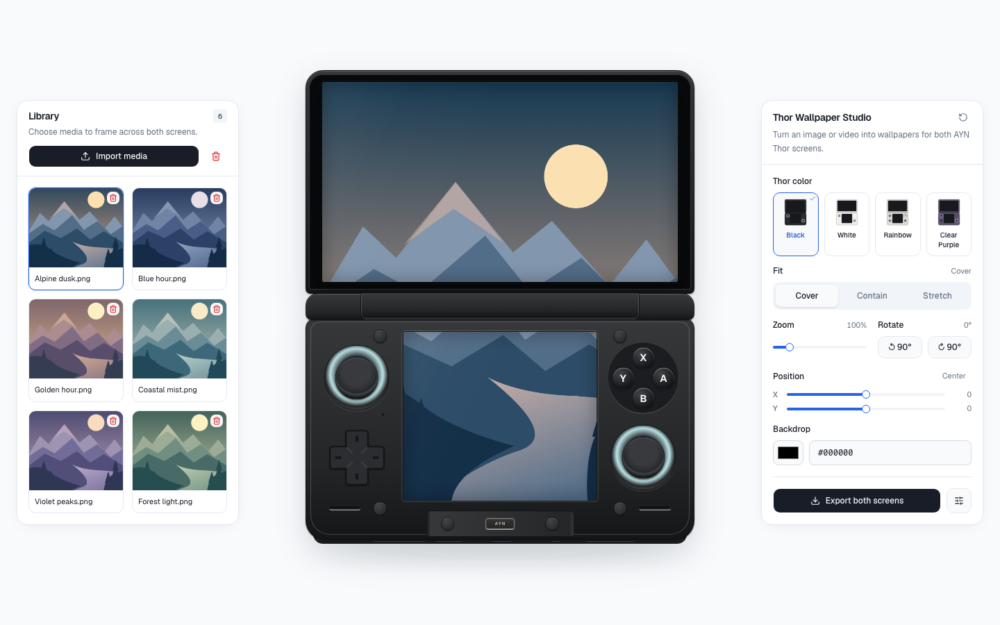
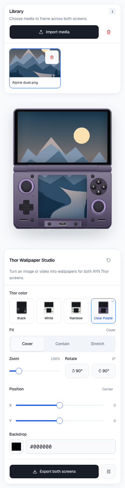

# Thor Wallpaper Studio

Create matching wallpapers for both AYN Thor screens from one image or video. Preview them on your device’s colorway, adjust the framing, and export both screens at native resolution.

**[Open Thor Wallpaper Studio →](https://ayn-thor-wallpaper-studio.pages.dev/)**

Free to use, works on desktop and mobile, and processes your files locally in your browser. No account or uploads needed.

## Screenshots

### Desktop



<details>
<summary>View the mobile layout</summary>

<p align="center">
  
</p>

</details>

## How to use it

1. **Import media.** Click **Import media** or drop an image or video onto the page. Select a thumbnail to use it across both screens.
2. **Adjust the preview.** Choose your Thor’s colorway: Black, White, Rainbow, or Clear Purple. Use the fit, zoom, position, rotation, and backdrop controls to frame your wallpaper. You can also drag either screen to pan; on desktop, scroll over a screen to zoom.
3. **Export both screens.** Open **Export settings** to choose a format, then click **Export both screens** to download the matching files.
4. **Apply them on your Thor.** Transfer the exported files to your device and set the wallpapers yourself; this tool doesn’t apply them automatically.

| Display | Export resolution |
| --- | --- |
| Top | 1920 × 1080 |
| Bottom | 1240 × 1080 |

Images export as **PNG, JPEG, or WebP**. Videos can export as a still frame or a **2–15 second clip** at 30 or 60 fps. Clip support and format depend on your browser; Chrome or Edge is recommended. Keep the tab visible while recording a clip.

The library holds up to **24 files**, with **six per page**. Both screens always share one wallpaper and the same framing adjustments.

## Privacy and saved files

Your images and videos stay in your browser and aren’t uploaded to a server. The library, selected wallpaper, and settings are saved locally so you can return to them later.

Saved files are specific to your browser and site address. Clearing site data removes them, and private browsing or storage limits may prevent saving. **Remove** and **Clear library** also delete the corresponding saved files.

## Run locally

Use **Node.js 24** and npm:

```bash
git clone https://github.com/davidrocha9/ayn-thor-wallpaper-studio.git
cd ayn-thor-wallpaper-studio
npm ci
npm run dev
```

Open the local URL printed by Vite, usually <http://localhost:5173>.

### Development commands

```bash
npm run build                # Type-check and build into dist/
npm run preview              # Preview the production build
npm run lint                 # Run Oxlint
node --test tests/*.test.mjs  # Run unit tests
```

Built with React, TypeScript, Vite, Tailwind CSS, and shadcn/ui.

<details>
<summary>Optional browser tests</summary>

With a local server running and Playwright installed:

```bash
node --test tests/responsive.browser.mjs
```

The suite checks responsive layouts, touch interactions, library pagination, exports, and favicons. Set `BASE_URL` to test a different server (default: `http://127.0.0.1:5173`). If Playwright is installed outside the project, set `PLAYWRIGHT_MODULE` to its `index.mjs` path.

</details>
